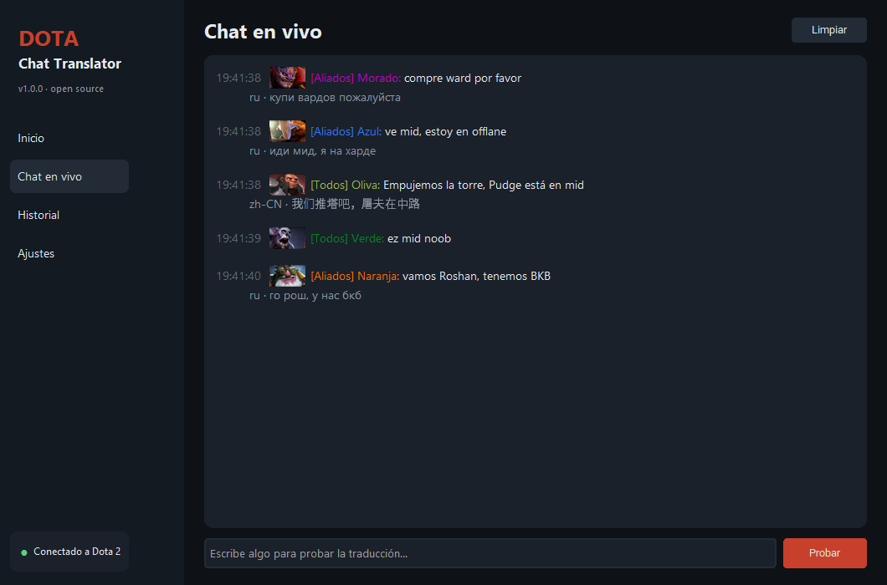

<p align="center">
  
</p>

<h1 align="center">Dota Chat Translator</h1>

<p align="center">
  Traductor del chat de Dota 2 en tiempo real, gratuito y de código abierto.<br>
  Entiende lo que escriben tus compañeros rusos, chinos o peruanos y respóndeles en su idioma.
</p>

<p align="center">
  <a href="../../releases/latest"><b>⬇ Descargar la última versión</b></a> ·
  <a href="README.md">Read in English</a>
</p>

---



## Qué hace

- **Traduce el chat de la partida en directo** y lo muestra en un overlay transparente encima de Dota 2, con el **retrato del héroe** que escribe y su color de jugador.
- **Responde en su idioma sin salir del juego**: pulsa **Ctrl+Enter** (equipo) o **Ctrl+Mayús+Enter** (todos) en Dota, escribe en la caja que aparece encima del juego, elige otro idioma si quieres, y la app lo traduce y lo envía al chat de Dota. También puedes escribirlo en la app y pegarlo tú.
- **Traducción natural con IA (opcional)**: inicia sesión con tu cuenta de ChatGPT Plus/Pro (sin clave) o usa una clave de Gemini, Claude, ChatGPT, Groq, DeepSeek, Mistral, Grok, OpenRouter o un modelo local. La traducción suena como la escribiría un jugador, entiende la jerga de Dota y el contexto de la partida, y distingue español de España y latinoamericano. Sin IA usa Google Translate.
- **Transcripción del chat de voz (experimental, opcional)**: todo lo que se habla en el audio de Dota se pasa a texto con Whisper en tu propia gráfica y se traduce, solo de `dota2.exe` (no de Discord). Eliges qué idiomas *no* se traducen.
- **Elige los idiomas**: traduce el chat a más de 30 idiomas; traduce tus mensajes a un idioma fijo o deja que la app detecte el del equipo.
- **Historial de conversaciones**: cada mensaje traducido se guarda en tu PC, con búsqueda, filtro por partida y exportación a CSV.
- **Entiende Dota**: héroes, objetos y jerga en inglés, español, ruso y chino (`мид`, `варды`, `axe ult`, `肉山`…) se tratan como términos del juego en vez de traducirse literalmente, y las abreviaturas del chat (`xq`, `щас`, `idk`…) se expanden antes. Puedes añadir las tuyas.
- **Se actualiza sola**: cuando hay una versión nueva en GitHub, la app pregunta si quieres instalarla.
- **Sin cuenta, sin suscripción y sin necesidad de API key.** Gratis y para siempre (la IA es opcional).
- Interfaz en español e inglés.

| Inicio | Historial |
|---|---|
|  |  |

## Empezar

1. Descarga **`DotaChatTranslator.exe`** de la [última release](../../releases/latest).
2. Ábrelo. Windows puede mostrar *«Windows protegió su PC»* porque la app no está firmada: pulsa **Más información → Ejecutar de todas formas** (ver [¿Es seguro?](#es-seguro)).
3. La app encuentra tu carpeta de Dota 2 e instala la integración sola. Si no la encuentra, indícala en **Ajustes → Dota 2**.
4. En Dota 2: **Ajustes → Vídeo → Modo de pantalla → Ventana sin bordes** (el overlay no se puede dibujar sobre la pantalla completa exclusiva).
5. **Reinicia Dota 2 una vez** para que cargue la integración. El estado de la app se pone en verde: *Conectado a Dota 2*.
6. Juega. Las traducciones aparecen a la izquierda de la pantalla, encima del chat de Dota.
7. Para responder: en Dota pulsa **Ctrl+Enter** (chat de equipo) o **Ctrl+Mayús+Enter** (chat de todos), escribe tu mensaje y pulsa **Enter**. La app lo traduce, abre el chat de Dota, lo pega y lo envía. **Esc** cancela. Los atajos y el envío automático se cambian en **Ajustes → Escribir desde el juego**.

Los atajos se registran con `RegisterHotKey`, la función estándar de Windows: la app no instala ganchos de teclado ni lee lo que escribes en el juego. Solo simula teclas (Enter, Ctrl+V) en el momento de enviar tu mensaje, y después restaura tu portapapeles.

### Opcional: traducción natural con IA

**Sin clave, con tu cuenta de ChatGPT Plus/Pro:** elige *ChatGPT · tu plan Plus/Pro* y pulsa **Iniciar sesión con ChatGPT**; se abre el navegador, das permiso y listo. Traduce gastando el uso de tu plan (puedes ponerle un tope a la app en *Gestionar uso*); las cuentas gratuitas de ChatGPT no pueden usarlo. Con **OpenRouter** también puedes pulsar **Conectar con OpenRouter** en vez de pegar una clave.

Servicios compatibles con tu propia clave de API: **Gemini**, **Claude** (Anthropic), **ChatGPT** (OpenAI), **Groq**, **DeepSeek**, **Mistral**, **Grok** (xAI), **OpenRouter** y tu **servidor propio/local** (Ollama, LM Studio…).

1. **Ajustes → Traducción → Motor de traducción** → elige el servicio.
2. Pulsa **Conseguir clave**, créala y pégala. Cada servicio guarda su propia clave, cifrada con tu usuario de Windows. El modelo se elige solo; puedes escribir otro.
3. Pulsa **Probar**: muestra el modelo usado y cuánto tardó. Si el servicio falla o se acaba la cuota, la app vuelve sola a Google Translate.

Gemini y Groq tienen plan gratuito; **Groq es el más rápido**. Un modelo local usa tu propia gráfica y compite con el juego por ella.

### Opcional: chat de voz (experimental)

**Ajustes → Chat de voz → Transcribir el chat de voz de Dota.** La primera vez descarga el motor de voz una sola vez (≈3 GB con gráfica NVIDIA: modelo Whisper + librerías de NVIDIA; ≈0,6 GB el modelo de CPU). Mientras alguien habla, Whisper usa la GPU alrededor de un segundo por frase; cuando nadie habla no consume prácticamente nada.

## Cómo funciona

- **Lectura del chat** con la **Game State Integration (GSI)** oficial de Valve, la misma que usan los overlays de streaming, Overwolf, STRATZ, etc. La app escribe un pequeño archivo de texto en `dota 2 beta/game/dota/cfg/gamestate_integration/` y Dota envía los eventos de la partida (incluido el chat) a `127.0.0.1`, tu propio PC. **La app nunca lee la memoria del juego, no inyecta código ni modifica archivos del juego.**
- **Traducción** con servicios públicos gratuitos (Google Translate, con MyMemory como respaldo). Si uno limita las peticiones, la app cambia sola al siguiente durante unos minutos. Con un servicio de IA configurado, traduce primero la IA (sabiendo que es chat de Dota, con los últimos mensajes como contexto) y Google queda de respaldo.
- **Tus mensajes** se escriben en la caja del atajo (o en la app), se traducen y se pegan en el chat de Dota.
- **Chat de voz**: se captura solo el audio del proceso `dota2.exe` (función "process loopback" de Windows, sin tarjetas de sonido virtuales). Un detector de voz (Silero VAD) corta cada frase hablada y Whisper la transcribe; se descartan el locutor y las frases que Whisper inventa con ruido. Las frases de los héroes también se transcriben. Los idiomas marcados en *No traducir estos idiomas* no se envían al traductor.
- **El overlay** es una ventana transparente aparte que deja pasar los clics del ratón.
- **Retratos de héroe**: la GSI solo dice *qué jugador* (0–9) escribió, no su héroe. La barra superior del HUD de Dota muestra los héroes en ese mismo orden, así que al llegar un mensaje la app recorta ese retrato pequeño de la ventana de Dota. Se procesa en tu PC y solo se guarda en tu historial. Las posiciones se adaptan solas a tu resolución; si no encajan en tu pantalla (ultrapanorámica, 4:3…), abre **Ajustes → Overlay → Calibrar retratos**, captura la barra superior de Dota y mueve los deslizadores hasta que los recuadros encajen con los retratos; los cambios se aplican al momento.

## ¿Es seguro?

- **VAC / baneos.** La app solo usa la GSI oficial de Valve, una ventana de overlay normal de Windows y captura de pantalla y audio como un programa de grabación. No engancha ni registra tu teclado; solo pulsa Enter/Ctrl+V cuando envías un mensaje desde la caja del atajo. No toca el proceso del juego. Aun así, este proyecto **no está afiliado ni respaldado por Valve**; úsalo bajo tu responsabilidad.
- **Aviso de Windows / antivirus.** El `.exe` no está firmado (los certificados cuestan dinero cada año), y las apps de Python de un solo archivo hechas con PyInstaller a veces dan falsos positivos en antivirus. Puedes:
  - comprobar el archivo con el `SHA256SUMS.txt` de cada release: `Get-FileHash .\DotaChatTranslator.exe` en PowerShell;
  - leer el código: cada release se compila automáticamente con [GitHub Actions](.github/workflows/release.yml) a partir de este repositorio;
  - o [ejecutarla/compilarla desde el código](#compilar-desde-el-código).
- **Privacidad.** Sin telemetría y sin cuentas. El **texto de los mensajes del chat se envía al servicio de traducción** (Google Translate / MyMemory, o el servicio de IA que configures; algunos planes gratuitos, como el de Gemini, pueden usar los textos para mejorar sus modelos), nada más. La voz se transcribe en tu PC; ningún audio sale de él. Los retratos se capturan y guardan en tu PC. Al arrancar, la app pregunta a la API pública de GitHub si hay versión nueva (se puede desactivar en Ajustes). El historial y los ajustes se quedan en tu PC.

## Ajustes y datos

Todo se guarda en `%APPDATA%\DotaChatTranslator\` (Ajustes → *Abrir carpeta de datos*):

| Archivo | Contenido |
|---|---|
| `config.json` | Tus ajustes |
| `history.db` | Historial de conversaciones (SQLite) |
| `glossary.json` | *(opcional)* tu propia jerga, mismo formato que [`app/glossary.json`](app/glossary.json) |
| `app.log` | Registro, útil para reportar errores |

### Desinstalar

1. En la app: **Inicio → Quitar integración** (borra el archivo que la app añadió a la carpeta `cfg` de Dota).
2. Borra `DotaChatTranslator.exe` y la carpeta `%APPDATA%\DotaChatTranslator`.

## Problemas frecuentes

| Problema | Solución |
|---|---|
| El estado se queda en *Esperando a Dota 2* | Reinicia Dota 2 tras instalar la integración. Revisa la carpeta en Ajustes → Dota 2. |
| No se ve el overlay | Usa **Ventana sin bordes** en Dota y comprueba que *Mostrar overlay en el juego* está activado. |
| No se transcribe el chat de voz | Comprueba que en Ajustes → Chat de voz el estado dice *Escuchando a Dota 2*, y que el idioma no está marcado en *No traducir estos idiomas*. |
| Los mensajes salen sin traducir | Los servicios gratuitos pueden estar limitando; la app reintenta con otro proveedor. Mira `app.log`. |
| *No se pudo abrir el puerto 53123* | Ya hay otra copia abierta, u otro programa usa ese puerto: cámbialo en Ajustes → Dota 2 → Puerto local y pulsa *Instalar integración* otra vez. |

## Limitaciones

- **Solo Windows**, con Dota 2 en ventana sin bordes o en ventana.
- La GSI identifica a quien escribe solo por **color de jugador**, no por nombre ni héroe; el retrato se toma de la pantalla, así que necesita la barra superior de Dota visible (calibrado en 16:9; otras proporciones pueden necesitar una calibración rápida en Ajustes).
- Los servicios de traducción gratuitos no son oficiales: la calidad es buena pero no perfecta, y podrían cambiar o limitar su uso en cualquier momento.

## Compilar desde el código

Requiere Windows y Python 3.10+.

```powershell
git clone https://github.com/Rucerdo/dota-translator.git
cd dota-translator
py -m pip install -r requirements.txt
py run.py            # ejecutar la app
.\build.bat          # generar dist\DotaChatTranslator.exe
```

### Publicar una versión nueva

1. Cambia `__version__` en `app/__init__.py` y añade los cambios a `CHANGELOG.md`.
2. Haz commit, crea la etiqueta y súbela: `git tag v1.0.1 && git push origin v1.0.1`.
3. GitHub Actions compila el `.exe` y publica la release con su checksum.

## Contribuir

Issues y pull requests son bienvenidos, sobre todo:

- **Jerga**: añade entradas a [`app/glossary.json`](app/glossary.json) para tu idioma.
- **Traducciones de la interfaz**: añade un idioma a `STRINGS` en [`app/i18n.py`](app/i18n.py).

## Licencia

[MIT](LICENSE). Dota 2 es una marca registrada de Valve Corporation. Este proyecto no está afiliado a Valve.
