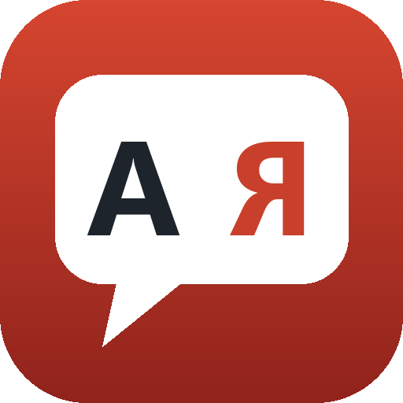
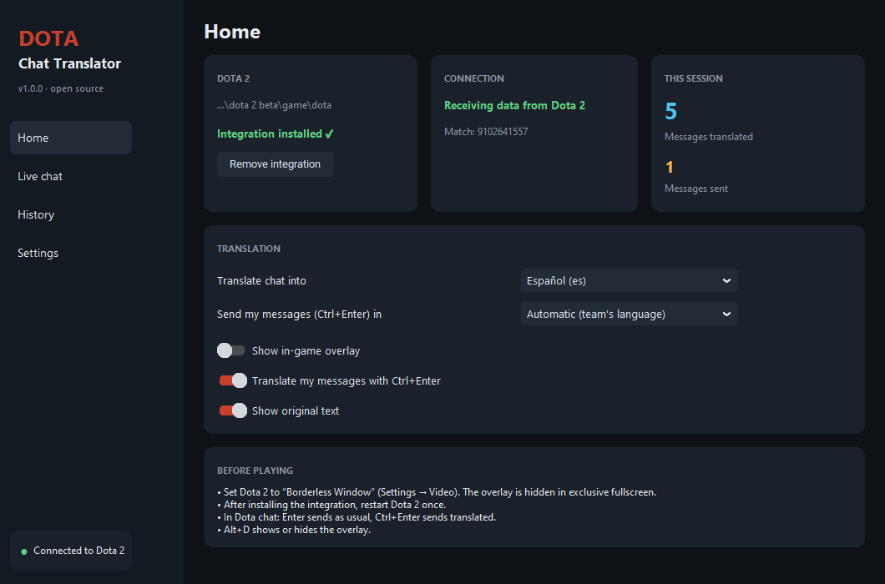
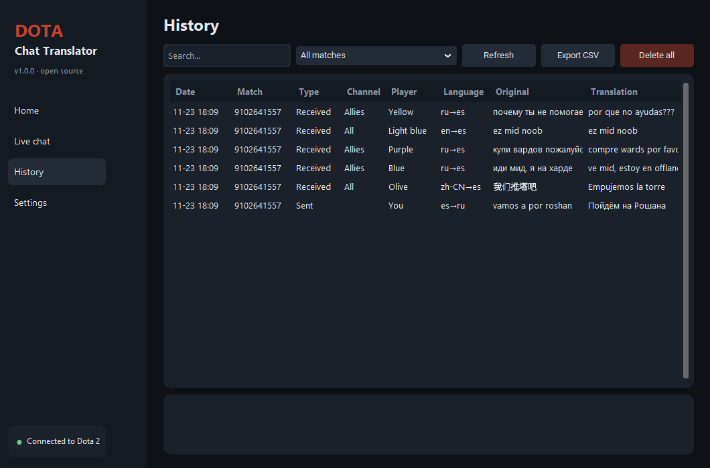

<p align="center">
  
</p>

<h1 align="center">Dota Chat Translator</h1>

<p align="center">
  Traductor del chat de Dota 2 en tiempo real, gratuito y de código abierto.<br>
  Entiende lo que escriben tus compañeros rusos, chinos o peruanos y respóndeles en su idioma.
</p>

<p align="center">
  <a href="../../releases/latest"><b>⬇ Descargar la última versión</b></a> ·
  <a href="README.md">Read in English</a>
</p>

---


## Qué hace

- **Traduce el chat de la partida en directo** y lo muestra en un overlay transparente encima de Dota 2, con el **retrato del héroe** que escribe y su color de jugador.
- **Responde en su idioma**: escribe en el chat de Dota como siempre y pulsa **Ctrl+Enter** en vez de Enter. Tu mensaje se traduce al idioma del equipo y se envía. Con Enter normal se envía tal cual.
- **Elige los idiomas**: traduce el chat a más de 30 idiomas; envía tus mensajes en un idioma fijo o deja que la app detecte el del equipo.
- **Historial de conversaciones**: cada mensaje traducido se guarda en tu PC, con búsqueda, filtro por partida y exportación a CSV.
- **Entiende Dota**: héroes, objetos y jerga en inglés, español, ruso y chino (`мид`, `варды`, `axe ult`, `肉山`…) se tratan como términos del juego en vez de traducirse literalmente, y las abreviaturas del chat (`xq`, `щас`, `idk`…) se expanden antes. Puedes añadir las tuyas.
- **Se actualiza sola**: cuando hay una versión nueva en GitHub, la app pregunta si quieres instalarla.
- **Sin cuenta, sin suscripción, sin API key.** Gratis y para siempre.
- Interfaz en español e inglés.

| Inicio | Historial |
|---|---|
|  |  |

## Empezar

1. Descarga **`DotaChatTranslator.exe`** de la [última release](../../releases/latest).
2. Ábrelo. Windows puede mostrar *«Windows protegió su PC»* porque la app no está firmada: pulsa **Más información → Ejecutar de todas formas** (ver [¿Es seguro?](#es-seguro)).
3. La app encuentra tu carpeta de Dota 2 e instala la integración sola. Si no la encuentra, indícala en **Ajustes → Dota 2**.
4. En Dota 2: **Ajustes → Vídeo → Modo de pantalla → Ventana sin bordes** (el overlay no se puede dibujar sobre la pantalla completa exclusiva).
5. **Reinicia Dota 2 una vez** para que cargue la integración. El estado de la app se pone en verde: *Conectado a Dota 2*.
6. Juega. Las traducciones aparecen a la izquierda de la pantalla, encima del chat de Dota.

### Atajos

| Tecla | Acción |
|---|---|
| `Ctrl+Enter` (en el chat de Dota) | Traducir tu mensaje y enviarlo |
| `Enter` (en el chat de Dota) | Enviar normal, sin traducir |
| `Alt+D` | Mostrar / ocultar el overlay |

Se pueden cambiar en **Ajustes → Atajos de teclado**.

## Cómo funciona

- **Lectura del chat** con la **Game State Integration (GSI)** oficial de Valve, la misma que usan los overlays de streaming, Overwolf, STRATZ, etc. La app escribe un pequeño archivo de texto en `dota 2 beta/game/dota/cfg/gamestate_integration/` y Dota envía los eventos de la partida (incluido el chat) a `127.0.0.1`, tu propio PC. **La app nunca lee la memoria del juego, no inyecta código ni modifica archivos del juego.**
- **Traducción** con servicios públicos gratuitos (Google Translate, con MyMemory como respaldo). Si uno limita las peticiones, la app cambia sola al siguiente durante unos minutos.
- **Envío traducido** (Ctrl+Enter): solo simula pulsaciones de teclado mientras Dota está en primer plano: seleccionar todo → copiar → traducir → pegar → Enter. No se escribe nada en el juego.
- **El overlay** es una ventana transparente aparte que deja pasar los clics del ratón.
- **Retratos de héroe**: la GSI solo dice *qué jugador* (0–9) escribió, no su héroe. La barra superior del HUD de Dota muestra los héroes en ese mismo orden, así que al llegar un mensaje la app recorta ese retrato pequeño de la ventana de Dota. Se procesa en tu PC y solo se guarda en tu historial. Las posiciones se adaptan solas a tu resolución; si no encajan en tu pantalla (ultrapanorámica, 4:3…), abre **Ajustes → Overlay → Calibrar retratos**, captura la barra superior de Dota y mueve los deslizadores hasta que los recuadros encajen con los retratos; los cambios se aplican al momento.

## ¿Es seguro?

- **VAC / baneos.** La app solo usa la GSI oficial de Valve y ventanas y pulsaciones normales de Windows, como cualquier overlay. No toca el proceso del juego. Aun así, este proyecto **no está afiliado ni respaldado por Valve**; úsalo bajo tu responsabilidad.
- **Aviso de Windows / antivirus.** El `.exe` no está firmado (los certificados cuestan dinero cada año), y las apps de Python de un solo archivo hechas con PyInstaller a veces dan falsos positivos en antivirus. Puedes:
  - comprobar el archivo con el `SHA256SUMS.txt` de cada release: `Get-FileHash .\DotaChatTranslator.exe` en PowerShell;
  - leer el código: cada release se compila automáticamente con [GitHub Actions](.github/workflows/release.yml) a partir de este repositorio;
  - o [ejecutarla/compilarla desde el código](#compilar-desde-el-código).
- **Privacidad.** Sin telemetría y sin cuentas. El **texto de los mensajes del chat se envía al servicio de traducción** (Google Translate / MyMemory) para traducirlo, nada más. Los retratos se capturan y guardan en tu PC. Al arrancar, la app pregunta a la API pública de GitHub si hay versión nueva (se puede desactivar en Ajustes). El historial y los ajustes se quedan en tu PC.

## Ajustes y datos

Todo se guarda en `%APPDATA%\DotaChatTranslator\` (Ajustes → *Abrir carpeta de datos*):

| Archivo | Contenido |
|---|---|
| `config.json` | Tus ajustes |
| `history.db` | Historial de conversaciones (SQLite) |
| `glossary.json` | *(opcional)* tu propia jerga, mismo formato que [`app/glossary.json`](app/glossary.json) |
| `app.log` | Registro, útil para reportar errores |

### Desinstalar

1. En la app: **Inicio → Quitar integración** (borra el archivo que la app añadió a la carpeta `cfg` de Dota).
2. Borra `DotaChatTranslator.exe` y la carpeta `%APPDATA%\DotaChatTranslator`.

## Problemas frecuentes

| Problema | Solución |
|---|---|
| El estado se queda en *Esperando a Dota 2* | Reinicia Dota 2 tras instalar la integración. Revisa la carpeta en Ajustes → Dota 2. |
| No se ve el overlay | Usa **Ventana sin bordes** en Dota. Comprueba que *Mostrar overlay en el juego* está activado y pulsa `Alt+D`. |
| Ctrl+Enter envía mi mensaje sin traducir | Activa *Traducir mis mensajes con Ctrl+Enter*. Si Dota se ejecuta como administrador, abre la app también como administrador. |
| Los mensajes salen sin traducir | Los servicios gratuitos pueden estar limitando; la app reintenta con otro proveedor. Mira `app.log`. |
| *No se pudo abrir el puerto 53123* | Ya hay otra copia abierta, u otro programa usa ese puerto: cámbialo en Ajustes → Dota 2 → Puerto local y pulsa *Instalar integración* otra vez. |

## Limitaciones

- **Solo Windows**, con Dota 2 en ventana sin bordes o en ventana.
- La GSI identifica a quien escribe solo por **color de jugador**, no por nombre ni héroe; el retrato se toma de la pantalla, así que necesita la barra superior de Dota visible (calibrado en 16:9; otras proporciones pueden necesitar una calibración rápida en Ajustes).
- Los servicios de traducción gratuitos no son oficiales: la calidad es buena pero no perfecta, y podrían cambiar o limitar su uso en cualquier momento.

## Compilar desde el código

Requiere Windows y Python 3.10+.

```powershell
git clone https://github.com/Rucerdo/dota-translator.git
cd dota-translator
py -m pip install -r requirements.txt
py run.py            # ejecutar la app
.\build.bat          # generar dist\DotaChatTranslator.exe
```

### Publicar una versión nueva

1. Cambia `__version__` en `app/__init__.py` y añade los cambios a `CHANGELOG.md`.
2. Haz commit, crea la etiqueta y súbela: `git tag v1.0.1 && git push origin v1.0.1`.
3. GitHub Actions compila el `.exe` y publica la release con su checksum.

## Contribuir

Issues y pull requests son bienvenidos, sobre todo:

- **Jerga**: añade entradas a [`app/glossary.json`](app/glossary.json) para tu idioma.
- **Traducciones de la interfaz**: añade un idioma a `STRINGS` en [`app/i18n.py`](app/i18n.py).

## Licencia

[MIT](LICENSE). Dota 2 es una marca registrada de Valve Corporation. Este proyecto no está afiliado a Valve.
