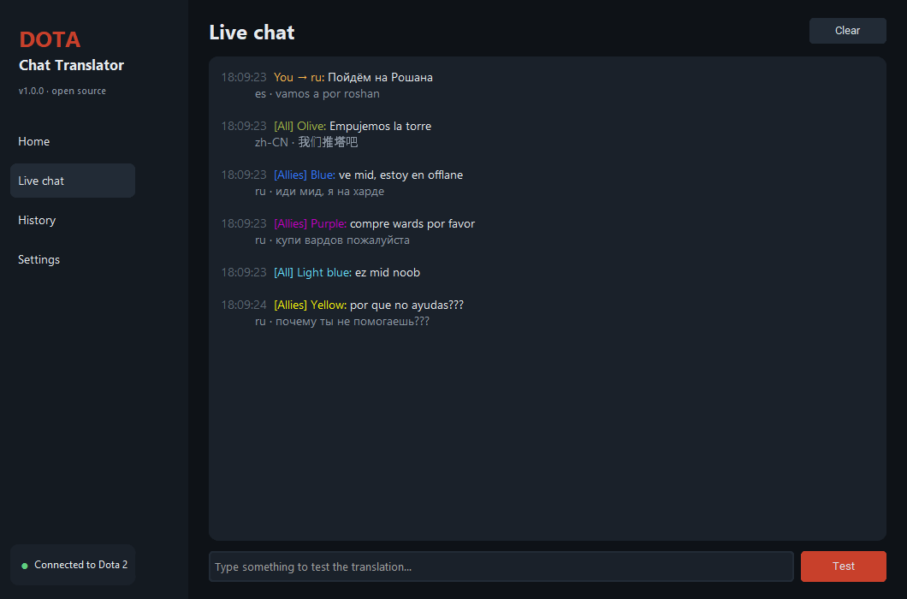
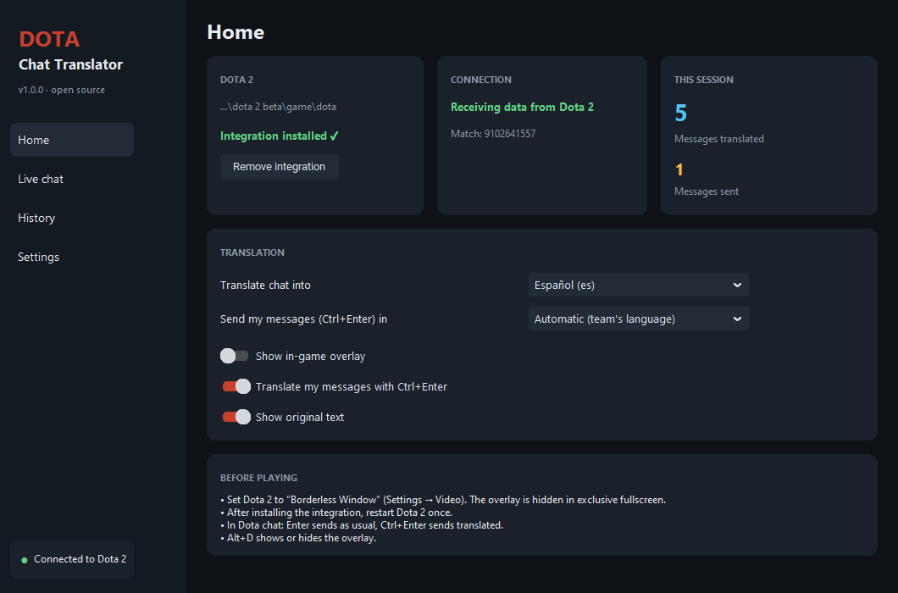
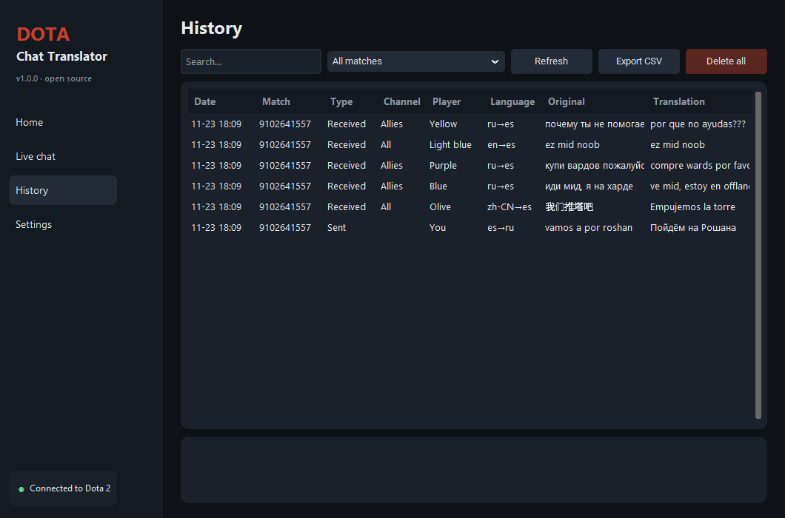

<p align="center">
  
</p>

<h1 align="center">Dota Chat Translator</h1>

<p align="center">
  Free, open-source, real-time translator for the Dota 2 chat.<br>
  Read what your Russian, Chinese or Peruvian teammates write, and answer them in their language.
</p>

<p align="center">
  <a href="../../releases/latest"><b>⬇ Download the latest release</b></a> ·
  <a href="README.es.md">Leer en español</a>
</p>

---



## Features

- **Live translation of the in-game chat** shown in a transparent overlay on top of Dota 2, coloured by player.
- **Reply in their language**: type in Dota chat as usual and press **Ctrl+Enter** instead of Enter. Your message is translated into the team's language and sent. Plain Enter still sends it untouched.
- **Pick your languages**: translate incoming chat into any of 30+ languages; send your messages in a fixed language or let the app detect the team's language automatically.
- **Conversation history**: every translated message is saved locally, searchable, filterable by match, exportable to CSV.
- **Knows Dota slang**: `мид`, `варды`, `керри`, `ez mid`… are kept as Dota terms instead of being translated literally (and you can add your own).
- **No account, no subscription, no API key.** It's free and always will be.
- English and Spanish interface.

| Home | History |
|---|---|
|  |  |

## Quick start

1. Download **`DotaChatTranslator.exe`** from the [latest release](../../releases/latest).
2. Run it. Windows may show *"Windows protected your PC"* because the app isn't code-signed: click **More info → Run anyway** (see [Is it safe?](#is-it-safe)).
3. The app finds your Dota 2 folder and installs the integration automatically. If it can't, set the folder in **Settings → Dota 2**.
4. In Dota 2 go to **Settings → Video → Display mode** and choose **Borderless window** (the overlay can't be drawn over exclusive fullscreen).
5. **Restart Dota 2 once** so it loads the integration. The app's status turns green: *Connected to Dota 2*.
6. Play. Translations appear on the left side of the screen, above Dota's own chat.

### Hotkeys

| Key | Action |
|---|---|
| `Ctrl+Enter` (in Dota chat) | Translate your message and send it |
| `Enter` (in Dota chat) | Send as usual, untranslated |
| `Alt+D` | Show / hide the overlay |

Both can be changed in **Settings → Hotkeys**.

## How it works

```
Dota 2 ──(Game State Integration, localhost)──► Dota Chat Translator ──► free translation service
                                                   │
                                                   ├─► overlay window on top of the game
                                                   └─► local history (SQLite)
```

- **Reading the chat** uses Valve's official **Game State Integration (GSI)**: the same feature used by stream overlays, Overwolf apps, STRATZ, etc. The app writes one small text file to `dota 2 beta/game/dota/cfg/gamestate_integration/` and Dota sends game events (including chat messages) to `127.0.0.1` on your PC. **The app never reads game memory, injects code or modifies game files.**
- **Translation** uses free public endpoints (Google Translate, with MyMemory as a fallback). If one of them rate-limits, the app automatically switches to the next one for a few minutes.
- **Sending translated messages** (Ctrl+Enter) only simulates keystrokes while the Dota 2 window is in front: select all → copy → translate → paste → Enter. Nothing is written into the game.
- **The overlay** is a separate transparent window that lets mouse clicks pass through.

## Is it safe?

- **VAC / bans.** The app only uses Valve's official GSI feature and normal Windows windows and keystrokes, like any other overlay. It doesn't touch the game process. That said, this project is **not affiliated with or endorsed by Valve**; use it at your own risk.
- **"Windows protected your PC" / antivirus warnings.** The `.exe` isn't code-signed (certificates cost money every year), and single-file Python apps built with PyInstaller are sometimes flagged by antivirus heuristics as false positives. You can:
  - check the file against the `SHA256SUMS.txt` published with each release: `Get-FileHash .\DotaChatTranslator.exe` in PowerShell;
  - read the source code: every release is built automatically by [GitHub Actions](.github/workflows/release.yml) from this repository;
  - or [run/build it from source](#build-from-source).
- **Privacy.** There is no telemetry and no account. The **text of chat messages is sent to the translation service** (Google Translate / MyMemory) to be translated, nothing else. History and settings are stored only on your PC.

## Settings and data

Everything is stored in `%APPDATA%\DotaChatTranslator\` (Settings → *Open data folder*):

| File | Contents |
|---|---|
| `config.json` | Your settings |
| `history.db` | Conversation history (SQLite) |
| `glossary.json` | *(optional)* your own slang entries, same format as [`app/glossary.json`](app/glossary.json) |
| `app.log` | Log file, useful when reporting bugs |

### Uninstall

1. In the app: **Home → Remove integration** (deletes the file the app added to Dota's `cfg` folder).
2. Delete `DotaChatTranslator.exe` and the `%APPDATA%\DotaChatTranslator` folder.

## Troubleshooting

| Problem | Fix |
|---|---|
| Status stays on *Waiting for Dota 2* | Restart Dota 2 after the integration is installed. Check the folder in Settings → Dota 2. |
| The overlay doesn't show | Use **Borderless window** in Dota. Check *Show in-game overlay* is on and press `Alt+D`. |
| Ctrl+Enter sends my message untranslated | Make sure *Translate my messages with Ctrl+Enter* is on. If Dota runs as administrator, run the app as administrator too. |
| Messages appear untranslated | The free translation services may be rate-limiting; the app retries with another provider. Check `app.log`. |
| *Could not open port 53123* | Another copy of the app is already running, or another program uses that port: change it in Settings → Dota 2 → Local port and click *Install integration* again. |

## Limitations

- **Windows only**, Dota 2 in borderless or windowed mode.
- GSI identifies the sender only by **player colour** (slot), not by name or hero.
- Free translation services are unofficial endpoints: quality is good but not perfect, and they could change or limit usage at any time.

## Build from source

Requires Windows and Python 3.10+.

```powershell
git clone https://github.com/<your-user>/dota-chat-translator.git
cd dota-chat-translator
py -m pip install -r requirements.txt
py run.py            # run the app
.\build.bat          # build dist\DotaChatTranslator.exe
```

Project layout:

```
app/
  gui.py          desktop window (CustomTkinter)
  core.py         engine: wires GSI, translation, overlay, history
  gsi.py          local Game State Integration server (chat events)
  translator.py   free translation with provider fallback + Dota glossary
  overlay.py      transparent click-through in-game overlay
  outgoing.py     Ctrl+Enter translate-and-send
  history.py      SQLite history
  dota.py         Dota 2 folder detection, GSI config install/remove
  i18n.py         UI strings (en/es) and language list
  glossary.json   Dota slang dictionary
run.py            entry point
```

### Releasing a new version

1. Update `__version__` in `app/__init__.py` and `CHANGELOG.md`.
2. Commit, then tag and push: `git tag v1.0.1 && git push origin v1.0.1`.
3. GitHub Actions builds the `.exe` and publishes the release with its checksum.

## Contributing

Issues and pull requests are welcome, especially:

- **Slang**: add entries to [`app/glossary.json`](app/glossary.json) for your language.
- **UI translations**: add a language to `STRINGS` in [`app/i18n.py`](app/i18n.py).

## License

[MIT](LICENSE). Dota 2 is a registered trademark of Valve Corporation. This project is not affiliated with Valve.
